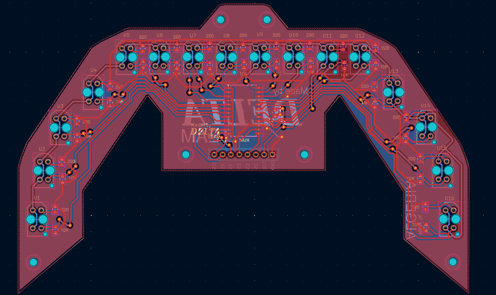
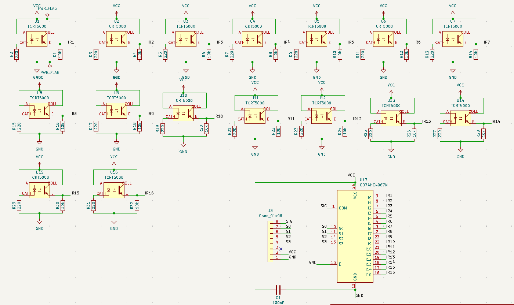
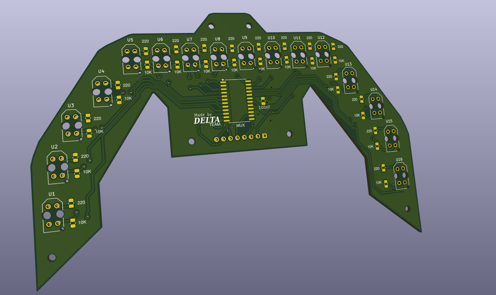
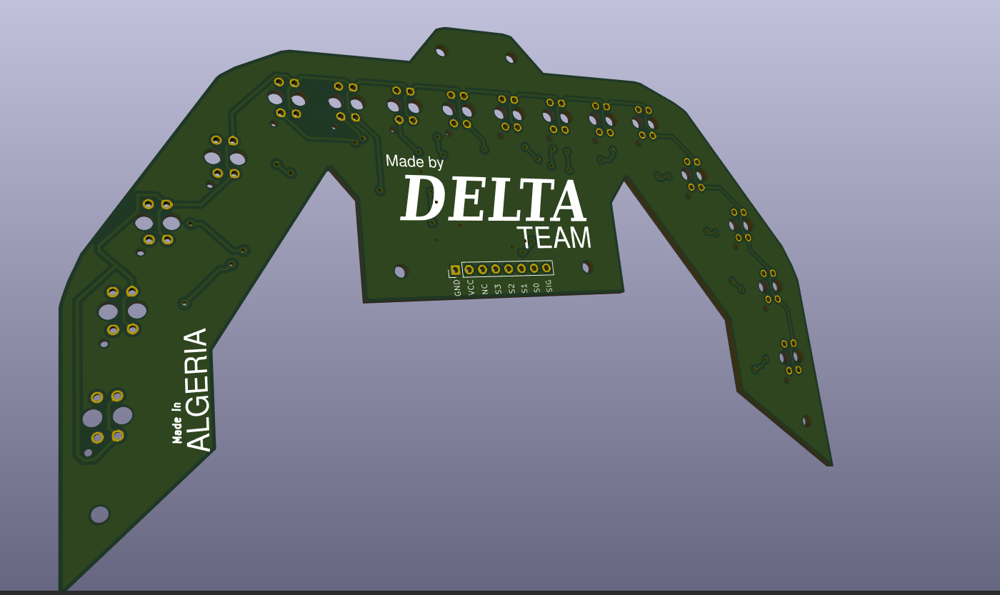

# 16-Channel IR Sensor Array PCB

> Personal hardware project for my robotics portfolio.

---

## Purpose

Design a custom 16-channel infrared sensor array PCB for future high-speed Line Follower robots.

This board will replace commercial sensor arrays and provide a platform for future improvements and experiments.

---

## Status

- [x] Schematic completed
- [x] PCB completed
- [x] 3D model verified
- [x] DRC passed
- [x] Gerber generated
- [x] Uploaded to GitHub

Version: **V1**

---

## Repository Structure

```
Hardware/
Images/
Manufacturing/
Backups/
README.md
```

---

## Images

### PCB Layout



### Schematic



### 3D Front



### 3D Back



---

## Main Specifications

- Software: KiCad
- Sensor Channels: 16
- PCB Type: 2 Layers
- Sensor Type: TCRT5000
- Target Robot: Line Follower

---

## Files Included

✔ KiCad Project

✔ Schematic

✔ PCB Layout

✔ Gerber Files

✔ 3D Images

✔ Backups

---

## Notes

Things I learned while designing this PCB:

- Organizing footprints before routing saves time.
- Keep signal routing clean and avoid unnecessary crossings.
- Always run DRC before generating Gerbers.
- Name files and folders consistently.
- Save manufacturing files separately from project files.

---

## Future Improvements

Version 2 ideas:

- Use SMD components where possible.
- Reduce PCB size.
- Improve sensor spacing.
- Add calibration LEDs.
- Add onboard multiplexer.
- Improve silkscreen readability.

---

## Manufacturing

Gerber files are available inside the repository.

---

## Author

Karim Rahou

National Higher School of Autonomous Systems

Personal learning project.
